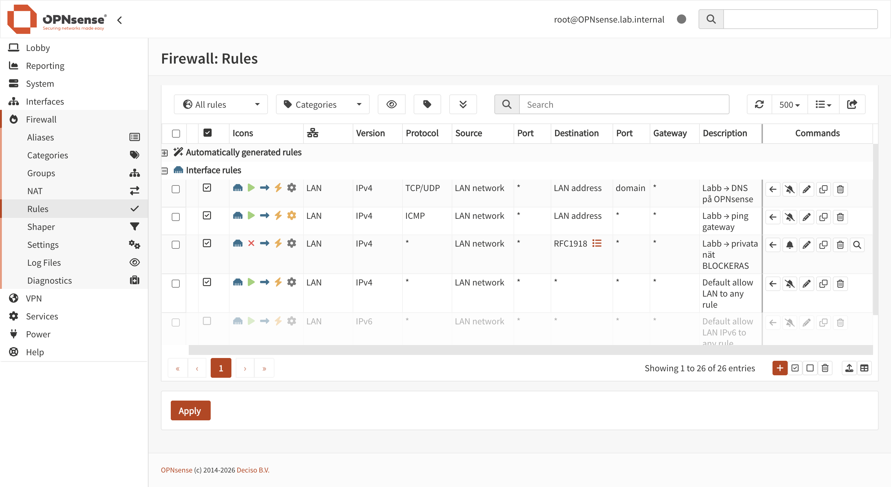
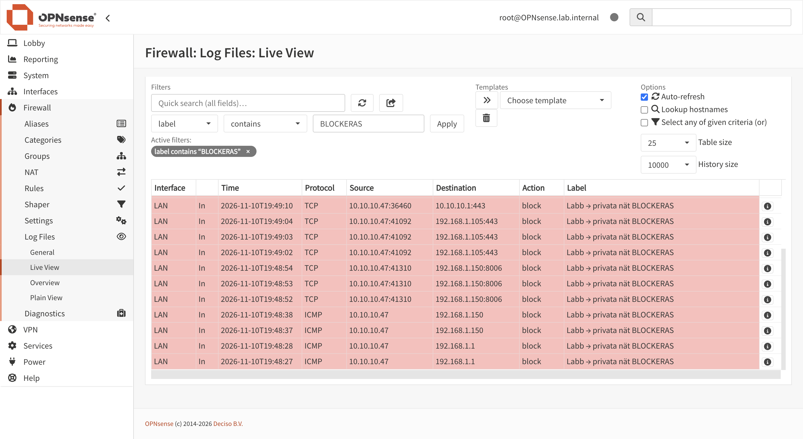

# 02 – Network segmentation with OPNsense

## TL;DR

I built an isolated lab network inside my Proxmox host, with an OPNsense VM as the only path in or out. The lab can reach the internet but nothing private: not my home network, not the hypervisor, and not the firewall's own admin interface. The most important lesson was that having no IP address is not the same as being unreachable: Linux had quietly given the lab bridge an IPv6 address, which would have let lab machines reach the Proxmox host directly, bypassing the firewall.

## Why a separate lab network?

I needed a separate segment so that nothing I do in the lab can break the home network or cause problems for the other people in the household. At first I thought of this mostly as good practice, but the later phases make it a hard requirement: tools like Responder answer name-resolution requests across the whole network in order to capture credentials. On the home network, that would mean capturing real password hashes from devices that belong to people who never agreed to be part of a lab. Segmentation is what makes it possible to run these attacks at all.

## Architecture

```
Internet
   │
ISP router 192.168.1.1          (home network 192.168.1.0/24)
   │
vmbr0 ── Proxmox host .150, service containers .101–.104
   │
   └── OPNsense WAN  192.168.1.105
       OPNsense LAN  10.10.10.1
              │
            vmbr1                (no physical port, no host IP)
              │
            lab 10.10.10.0/24    (DHCP .100–.200, .2–.99 reserved for static hosts)
```

My server only has one network card, and I solved that with a virtual router: an OPNsense VM. I don't need to connect any physical computers to the lab, so there was no reason for a second network card. Proxmox already had one virtual switch, vmbr0, which is attached to the server's only physical NIC and therefore to the home network. I created a second one, vmbr1, which isn't attached to any physical port and only exists inside the Proxmox host. OPNsense has one virtual NIC in each switch, which makes it the only path between the home network and the lab, so all lab traffic is forced through the firewall. All lab machines are virtual, so they connect to vmbr1 without any cables. A second physical NIC only becomes relevant if a physical device needs to join the lab.

The lab sits behind two layers of NAT (lab, then OPNsense, then the ISP router). For a lab that only needs outbound traffic, that's fine.

## Keeping the hypervisor out of the lab

If the Proxmox host had an IP address on vmbr1, every lab machine, including the Kali box coming in phase 4, could reach the Proxmox login on port 8006 and SSH on port 22 directly, without passing through the firewall. The Proxmox host controls every machine, so anyone who gets in there owns my entire lab and every service I run.

So I left the bridge without an IP address, but when I checked it, it still had one:

```
$ ip -br addr show vmbr1
vmbr1    UNKNOWN    fe80::b039:6bff:fe69:4fae/64
```

Linux gives every interface an IPv6 link-local address by default, and since Proxmox listens on all addresses, IPv6 included, the host would still have been reachable from the lab, just over IPv6. I disabled IPv6 on vmbr1 only, in `/etc/network/interfaces`:

```
post-up sysctl -w net.ipv6.conf.vmbr1.disable_ipv6=1
```

I verified it from a test machine in the lab by pinging the all-nodes multicast address `ff02::1`: the only reply came from the test machine itself. So having no IP address is not the same as being unreachable.

## Installing the firewall without breaking the home network

OPNsense's default configuration makes the first network card the LAN, with the address 192.168.1.1 and a DHCP server enabled. In my VM, the first card was the one connected to the home network. Booting it like that would have put two devices on the same address, OPNsense and my ISP router, which would have caused an address conflict. It would also have put a second DHCP server on the home network, a so-called rogue DHCP server. If my partner's phone joined the Wi-Fi, it would take the address from whichever server answered first. If that happened to be OPNsense, the phone would be connected to the Wi-Fi with no way out to the internet, so nothing would work.

To avoid this, I started the VM with the WAN card's link set to down (`link_down=1`), effectively an unplugged cable, and only reconnected it once the interfaces were assigned and re-addressed. The VM is defined in a script, and the script has this built in, so the lesson lives in code and not just in my memory.

## Firewall rules

| # | Action | Source | Destination | Port | Purpose |
|---|---|---|---|---|---|
| 1 | Pass | LAN net | LAN address | 53 TCP/UDP | DNS on the firewall |
| 2 | Pass | LAN net | LAN address | ICMP echo | Ping the gateway |
| 3 | Block (logged) | LAN net | RFC1918 alias | any | No private networks |
| 4 | Pass | LAN net | any | any | Internet |



`RFC1918` is an alias for `10.0.0.0/8`, `172.16.0.0/12` and `192.168.0.0/16`. Rules 1 and 2 have to come before rule 3, because the firewall's own LAN address is inside `10.0.0.0/8`. Blocked traffic is dropped silently rather than rejected, so the lab gets no confirmation that anything exists behind the block.

### Rule order is the logic

The logic of a firewall lies in the order of its rules: they are evaluated from the top, and the first rule that matches decides what happens to the packet. When I created my LAN rules, they ended up below the default "allow LAN to any" rule. That rule matches all traffic from the lab, so the firewall would never have reached my block rule. The lab would still have had full access to my home network, even though the block rule existed and looked correct in the list. I moved my rules above the default rule before applying anything.

### The anti-lockout rule

OPNsense has an automatic anti-lockout rule that exists from the start and is evaluated before any of my own rules, so my block rule couldn't override it. The rule lets the LAN side reach the firewall's admin page and SSH. In my setup the LAN is the lab, which is where the Kali machine will be. Without disabling it, the attack machine could have tried to log in to the firewall that protects everything. I manage the firewall from the home network through a separate WAN rule instead.

## Troubleshooting: ARP vs. ping

After reconnecting the WAN, the firewall didn't answer ping from the Proxmox host. That alone was expected, since the WAN side drops everything by default. What told me something was actually wrong was ARP. ARP only asks whether any machine lives at a given IP address, and firewall rules don't filter it, while ping can be left unanswered, which is exactly what the firewall protects against. So silent ping together with an ARP reply means the host is there and the firewall is dropping the traffic.

But `ip neigh` showed `FAILED`: nothing answered ARP at all. That meant no device had the address 192.168.1.105. Checking from the OPNsense console showed the WAN had fallen back to DHCP and picked up .124 instead. After setting the static address again and rebooting to confirm it stuck, ARP showed the firewall's MAC address as `REACHABLE`.

The same thing happened with the DHCP range: the range I set in the console (.100–.200) had been overwritten by the setup wizard (.41–.245), which I only noticed because the test machine got the address .47. That matters later, because the domain controllers in the AD lab will need static addresses outside the DHCP range.

What I took from this: verify what is actually running instead of trusting what I configured, preferably after a reboot.

## Verification

Instead of blindly trusting that the rules worked, I tested them from a throwaway Debian container placed in the lab network, exactly where future lab machines will be. I tested both directions: things that should work and things that should fail. The positive tests matter too: if everything had failed, the blocked results wouldn't prove anything, because the network might just have been broken. Only when the internet works and the home network is blocked do I know the rules are doing the job.

| Test from lab machine | Expected | Result |
|---|---|---|
| Ping gateway 10.10.10.1 | works | works |
| DNS lookup | works | works |
| Internet (ping 1.1.1.1, `apt update`) | works | works |
| ISP router 192.168.1.1 | blocked | blocked |
| Proxmox host (ping + TCP 8006) | blocked | blocked |
| Firewall admin via WAN address :443 | blocked | blocked |
| Firewall admin via LAN address :443 | blocked | blocked |
| IPv6 link-local neighbours | no other hosts | no other hosts |

TCP tests used bash's built-in `/dev/tcp`, so nothing had to be installed:

```
timeout 3 bash -c '</dev/tcp/192.168.1.150/8006' && echo OPEN || echo blocked
```

Every blocked attempt also shows up in the firewall's live log under the block rule:



## What's not done yet

The first thing I'd fix is the admin rule. Right now it allows the whole home network to reach the firewall's login page, so any device at home, including a compromised phone or a poorly secured smart TV, could try to log in. Following the principle of least privilege, it should only allow my own machine.

Other things that are deliberately left for later:

- The configuration only lives in the web UI. Phase 2 moves infrastructure to code. The exported firewall config contains secrets, so it stays out of this public repo until I have a proper way to handle them.
- Backups run weekly, not nightly.
- The firewall logs will feed into Wazuh in phase 3. They're already full of broadcast and multicast noise from the home network, and learning what normal traffic looks like is part of the next phase.
